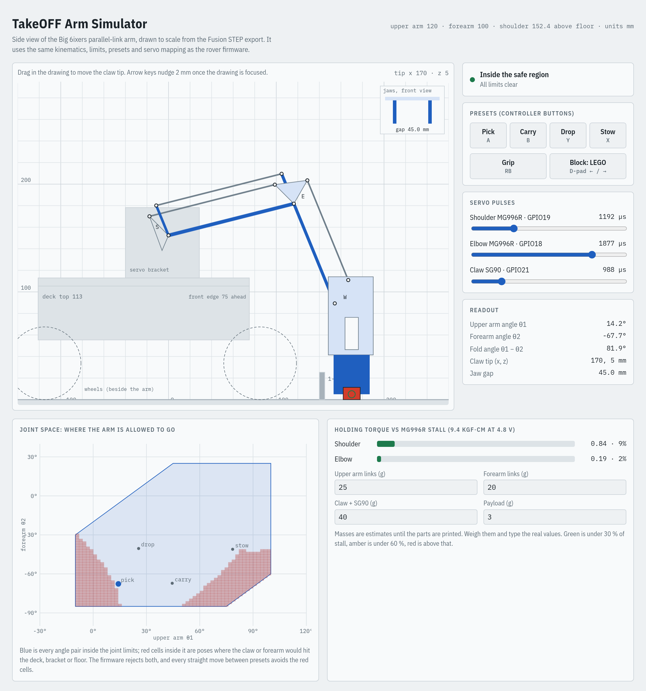
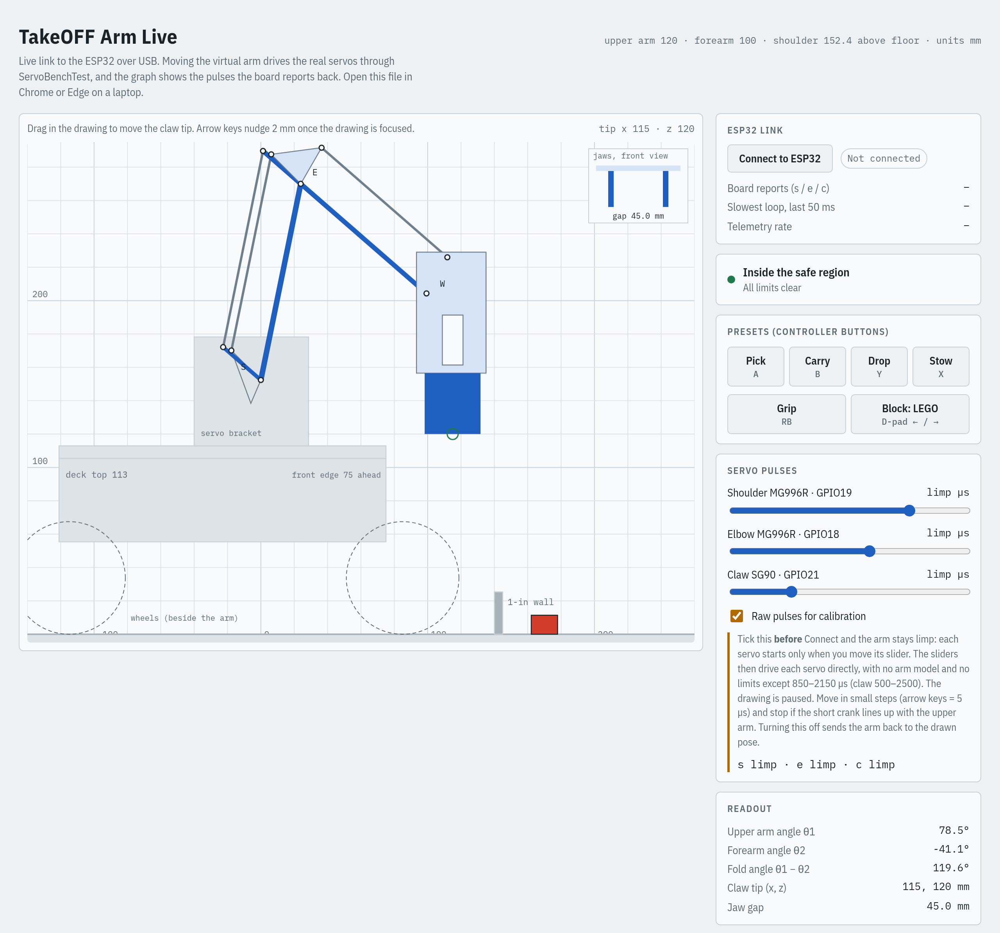

# TakeOFF Rover firmware (rebuilt from the CAD, 2026-11-26)

ESP32 + Xbox Wireless controller (Bluepad32). The arm geometry comes from the Fusion
assembly exported as `TakeOFF_Rover.stp`, plus one measurement taken on the built rover.

| Folder | What it is |
|---|---|
| `TakeOffRover/` | Rover firmware: drive, arm IK with deck/bracket keep-out, presets, claw, failsafe |
| `DriveBenchTest/` | Drive bench test over Serial: per-side drive, direction check, and a creep test that measures `MIN_EFFECTIVE` |
| `ServoBenchTest/` | Servo bench test and calibration over Serial (`s`/`e`/`c <µs>`, `x`, `t`, `h`) |
| `tools/arm_check.cpp` | PC test of the arm math: presets, moves between them, pulse ranges |
| `pages/takeoff-drive-live.html` | Guided wheel check over USB: pin map, each side's direction, and the `MIN_EFFECTIVE` creep test, with the `config.h` lines written out at the end (needs `DriveBenchTest` flashed) |
| `pages/takeoff-arm-sim.html` | Offline arm simulator, any browser. Same geometry, limits, keep-out and presets as the firmware |
| `pages/takeoff-arm-live.html` | Same simulator plus a USB link: with `ServoBenchTest` flashed, the virtual arm drives the real servos (Chrome, Edge or Brave) |
| `cad/TakeOFF_Rover.stp.zip` | Fusion assembly as STEP (zipped; 55 MB unzipped). The arm numbers in the firmware come from this |
| `archive/` | The original handoff zips the project started from (old firmware, kept for reference only) |

Both sketches compile with **esp32_bluepad32 4.1.0**, board **ESP32 Dev Module**. `ServoBenchTest` is running on the
rover; `TakeOffRover` has not been flashed yet (it waits on the arm calibration below).

## Web pages

Open either page straight from the folder (double-click it, no server needed).

**Simulator** (`pages/takeoff-arm-sim.html`), shown at the Pick preset. Drag the claw tip or press a preset; the
joint-space chart shows every pose the firmware allows (red cells would hit the deck, bracket or floor).



**Live page** (`pages/takeoff-arm-live.html`), shown with raw calibration mode ticked before connecting, so every servo
is still limp. Connect to ESP32 talks to `ServoBenchTest` over USB.



## Wiring

| Part | GPIO |
|---|---|
| Shoulder MG996R (horn carries the 120 mm upper arm) | **19** |
| Elbow MG996R (horn carries the 30 mm crank → push rod → forearm) | **18** |
| Claw SG90 | **21** |
| L298N ENA / IN1 / IN2 | 25 / 26 / 27 (not re-checked since the rewire) |
| L298N ENB / IN3 / IN4 | 33 / 32 / 13 (not re-checked since the rewire) |
| Battery sense (only with the divider fitted; set `HAVE_VBAT_SENSE`) | 34 |

## Arm geometry

Origin on the shoulder servo axis, x forward, z up. The claw tip is the claw centre at the bottom of the fingers.

| Value | mm | Source |
|---|---|---|
| Upper arm / forearm / crank / push rod | 120 / 100 / 30 / 120 | STEP |
| Shoulder axis above the floor | 152.4 | measured (~6 in); CAD says 160.2 |
| Wrist pin → finger bottom | 84.3 | STEP |
| Claw centre ahead of the wrist pin | 15.7 | STEP |
| Deck top below the shoulder axis | 39.5 | STEP |
| Deck front edge ahead of the shoulder axis | 75.0 | STEP |
| Servo bracket: forward reach / top above the shoulder axis | 28.6 / 25.8 | STEP |
| Jaw gap fully open | 45.8 | STEP |

Joint limits: upper arm −10…100°, forearm −85…25°, fold angle 20…160°. Inside those limits the
fingers reach the floor anywhere from about **140 to 222 mm** ahead of the shoulder axis.

Presets (x ahead of the shoulder axis, z = finger bottom above the floor):
Pick (170, 5) · Carry (140, 60) · Drop over wall (200, 55) · Stow (115, 120).
The Stow preset matches the pose the CAD is drawn in. `tools/arm_check` confirms each preset is ≥17° inside every joint limit
and that all 12 moves between presets stay clear of the deck and bracket.

## Arm and claw motion

Both the arm and the jaws run one shared profile (`motion::step` in `arm_kinematics.h`, pure math so
`tools/arm_check` tests the same code the firmware runs). Nothing steps to full speed in a single 20 ms
tick or stops dead on arrival any more.

**Preset moves** run along the move's own length in degrees, so they accelerate away from the start pose and
decelerate into the target. Pick → Stow is 64.3° and takes 0.98 s, peak jerk 300 °/s³ against the old ramp's
effectively infinite one. `ARM_PRESET_ACCEL_DEG_S2` is the dial.

**Right-stick trim** ramps the tip velocity instead of snapping to it, and brakes harder than it accelerates
(the same asymmetry `drive.h` already uses for the motors): full speed in 0.20 s, stopping in 0.08 s after
about 2.9 mm of coast. Whichever axis is against a limit has its velocity zeroed, so it cannot wind up and
lurch when the tip comes free.

## Claw motion

The jaws run a speed- and acceleration-limited profile (`claw::step` in `arm_kinematics.h`, pure math so
`tools/arm_check` tests the same code the firmware runs), instead of stepping to full speed in one 20 ms tick
and stopping dead on arrival. `tools/arm_check` prints the before and after:

| | Open → LEGO grip | Acceleration | Jerk |
|---|---|---|---|
| Constant-speed ramp (before) | 0.77 s | 2000 mm/s² | 100000 mm/s³ at both ends |
| Profile (now) | **0.68 s** | 420 mm/s² | 392 mm/s³ |

So the grip is both quicker and far smoother: the old ramp went from rest to the full rate in one 20 ms tick and
stopped dead on arrival, which is the snatch. Tunables are in `config.h`:

| Value | Default | What it does |
|---|---|---|
| `CLAW_MM_S` | 55 mm/s | Peak jaw speed. An SG90 moves the gap at ~175 mm/s unloaded, so the profile is the limit, not the servo |
| `CLAW_ACCEL_MM_S2` | 420 mm/s² | Ease in/out; reaches peak speed in ~0.13 s. Lower it for a gentler feel, raise it for a snappier one |
| `CLAW_TRIGGER_DB` | 0.06 | RT travel ignored before the trigger takes over |
| `CLAW_TRIGGER_TAU` | 0.05 s | RT smoothing, so thumb shake and ADC noise don't reach the fingers |
| `CLAW_RELIEF_MM_S` | 2.5 mm/s | Creep rate when easing a long squeeze |
| `claw::LEGO_GRIP_US` | 2087 µs | **Grip-strength dial.** The pulse that holds a LEGO brick |
| `claw::DUPLO_GRIP_US` | 1544 µs | The pulse that holds a Duplo brick |
| `claw::RELIEF_US` | 40 µs | How far the squeeze eases off after a long hold |
| `claw::MIN_US` | 700 µs | The fully-open end. This alone caps how wide the jaws go |

`OPEN_GAP` is derived from `MIN_US` rather than being a fixed millimetre figure, so "open" always means the
open pulse limit and capping the opening is a one-line change that survives recalibration.

**Grip strength is set as a pulse, not a squeeze in millimetres.** The mm scale depends on `US_PER_DEG` and
`REF_GAP`, which are still uncalibrated, so a figure in mm does not mean what it says — a pulse does.
Converting a pulse into the internal mm coordinate and back is exact, so the jaws land on precisely the pulse
set here whatever the calibration turns out to be. To retune: close the claw on the block in the live page
until it holds firmly, and put that pulse in `LEGO_GRIP_US` / `DUPLO_GRIP_US`. **Longer pulse = harder grip.**

**RT squeezes the claw proportionally** and overrides the RB latch while held; let go and the jaws hold the gap they
reached, so a block stays gripped without keeping a finger on the trigger. RB still toggles full open / full grip for
carrying hands-free.

A command that reverses faster than the jaws can brake is overshot slightly rather than stopped dead: position follows
the command late, but the acceleration limit is never broken. That is deliberate — stopping dead is exactly what the
driver feels as the claw snatching.

## Wheels

`DriveBenchTest` verifies the L298N wiring without flashing the rover firmware, so the wheels can be
brought up while the arm is still waiting on its calibration. Serial Monitor at 115200, Newline.

| Command | What it does |
|---|---|
| `a <v>` / `b <v>` | One side at a time, `v` = −1.00…1.00. This is how you check the pin map and each side's direction |
| `d <v>` | Both sides together |
| `c a` / `c b` | Creep test: ramps that side's duty up from zero until you send any line. **That duty is `MIN_EFFECTIVE`** |
| `s` / `x` | Brake / coast |
| `p` | Print the pin map |

`pages/takeoff-drive-live.html` drives all of this from a browser instead, as a guided check: it reads the pin
map off the board, runs each side, runs the creep test with a big button to hit the moment a wheel turns, and
writes out the `config.h` lines at the end. Chrome, Edge or Brave, same as the arm page. Space or Escape is a
panic stop.

**Wheels off the ground for the first run** — a miswired bridge drives at full duty. Every command restarts a
3 s deadman, so a typo cannot leave the rover driving off the bench. The page holds a command alive while a
control is set, the way holding a stick would, and brakes if the tab is hidden or closed.

Order: `p` and check the pins against the real wiring → `a 0.6` (only the left pair, forwards) → `b 0.6` →
`d 0.6` and `d -0.6` → `c a` and `c b`, take the larger and add ~0.02. A side that runs backwards sets its
`LEFT_INVERT` / `RIGHT_INVERT` in `config.h`; nothing moving, or both sides moving at once, means the wiring
does not match the pin map.

## Steering

`MIN_EFFECTIVE` is the smallest duty that turns a wheel. Applying it to each side on its own floored the
**inner** wheel of a turn up to that duty, so it turned when it should barely move and fought the turn:

| Case | Commanded | Per-side floor | Pair floor (now) |
|---|---|---|---|
| Full arc | 1.50:1 | 1.33:1 | **1.50:1** |
| Half arc | 2.33:1 | 1.63:1 | **2.33:1** |
| Precision arc | 5.00:1 | 1.38:1 | outer drives, inner coasts |
| Tight and slow | 4.33:1 | 1.88:1 | outer drives, inner coasts |

The floor is now applied to the **pair** (`drive_mix.h`): the larger side gets exactly the duty it always got,
and the smaller keeps its commanded share. A side whose share falls below `MIN_EFFECTIVE` is **coasted**
rather than driven, because that duty cannot turn a wheel — energising it would only hold the motor stalled,
drawing current and making heat. Coasting also scrubs less on the inside of a turn.

Straight-line behaviour is unchanged, and `tools/arm_check` asserts that against the old formula across the
speed range, so this only ever affects turns. Set `PRESERVE_TURN_RATIO = false` in `config.h` to go back.

Measuring the real `MIN_EFFECTIVE` with `DriveBenchTest` matters here too: the lower it is, the less often the
inner wheel needs to coast at all.

## Bring-up

1. **Horns off.** Flash `ServoBenchTest`, Serial Monitor 115200 with Newline, type `h`.
2. `c 1500`, `s 1500`, `e 1500`: each servo moves and holds. Watch the servo rail voltage (sag below ~4.6 V = regulator too weak).
3. Fit the horns at 1500 µs so the upper arm sits **45° above** forward-horizontal and the forearm **30° below** it.
4. **Direction:** `s 1550` should tip the upper arm up/back; `e 1450` should lift the front of the forearm.
   The two servos face each other, so the signs in `arm_kinematics.h` are opposite (`SHOULDER +10`, `ELBOW −10`).
   If one is backwards, flip **both**.
5. Claw: find the open/closed pulses and measure the gap at 1500 µs → `claw::REF_GAP`, `OPEN_SIGN`, `MIN_US`/`MAX_US`.
6. Flash `TakeOffRover` with the wheels off the ground. Check pairing, that switching the controller off stops the motors,
   and each motor's direction (`LEFT_INVERT` / `RIGHT_INVERT`). Serial prints the tip position and pulses at 5 Hz.
7. Press **A** (Pick) on the floor. If the fingers don't sit ~5 mm above the floor, adjust `SHOULDER_H` in `arm_kinematics.h`
   and rerun `tools/arm_check`.

## Calibrating the arm with the live page (horns already fitted)

The horns are on at unknown angles, so measure each joint instead of refitting them. Angles are measured
from forward-horizontal (a phone level app or a set square against the deck works). Before you start:
ServoBenchTest is on the ESP32, the page is reloaded, and Brave/Chrome has the port (no Serial Monitor open).

1. Tick **Raw pulses for calibration**, *then* press Connect. The arm stays limp until you move a slider.
2. Hold the arm. **Elbow slider** first: forearm **level** (0°) → note `e`.
3. **Shoulder slider**: upper arm **straight up** (90°) → note `s`. Then upper arm **45° up, leaning forward** → note `s`.
4. **Elbow slider** again (upper arm still at 45°): forearm pointing **45° down** at the front → note `e`.
5. **Claw slider**: jaws fully open (stop before it strains) → note `c`; jaws closed on a LEGO brick → note `c`.
6. Move shoulder and elbow to the **stow pose** you want → note `s` and `e`.

Always keep the short crank well away from lining up with the upper arm: that is where the linkage goes flat and twists.
The `s … · e … · c …` line under the checkbox selects with one click, so you can copy it. Disconnect no longer resets the board, so the servos
keep holding after you disconnect.

From these numbers: shoulder µs/° = (s₉₀ − s₄₅)/45 and `SHOULDER.us0` = s₄₅; elbow µs/° = (e₋₄₅ − e₀)/−45 and
`ELBOW.us0` = e₀ − 30 × that rate. Stow comes from the stow pulses through the forward kinematics.

Run the PC check after changing any geometry or preset:

```bash
g++ -std=c++17 -O2 -Wall -ITakeOffRover tools/arm_check.cpp -o /tmp/arm_check && /tmp/arm_check
```

## Not done yet

- If you change geometry, presets, servo signs or the claw motion profile in `arm_kinematics.h` / `config.h`, make the
  same change at the top of the script in both pages (they keep their own copy of the numbers). `CLAW_MM_S` /
  `CLAW_ACCEL`, `PRESET_ACCEL` and the two profile blocks in each page's frame loop must match `motion::step`.
- The claw's `REF_GAP`, `US_PER_DEG`, `MIN_US` and `MAX_US` are still placeholders, so the *gap in mm* the firmware
  thinks it has is not yet the real one. The motion is smooth either way — the profile works in mm and only the mm-to-µs
  mapping is uncalibrated — but grip width is not trustworthy until step 5 of bring-up is done.
- Battery type and regulator rating are unconfirmed. Motor pins and `MIN_EFFECTIVE` are unconfirmed but
  `DriveBenchTest` now measures both without flashing the rover firmware.
- `PRESERVE_TURN_RATIO` (see **Steering**) has only been checked on the PC. Drive it both ways on the rover
  and keep whichever feels right.
- The keep-out models the deck, the bracket and the floor only. It doesn't cover the wheels (they sit outside the arm's
  line) or the claw folding back into the arm's own links.
